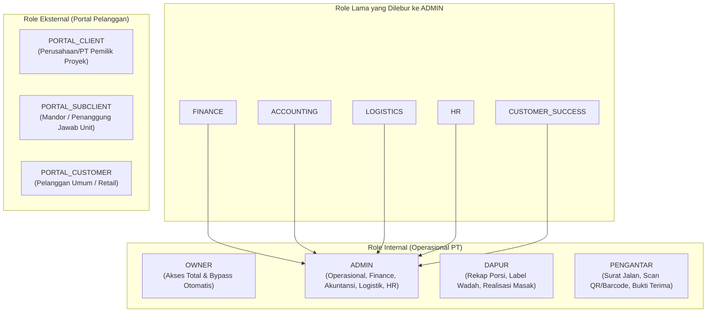
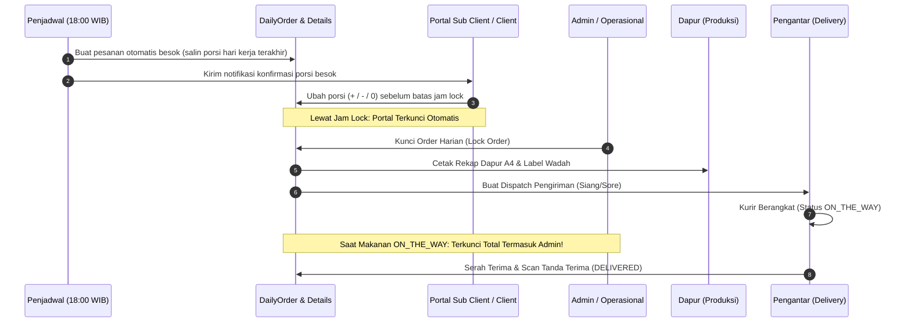

# DOKUMENTASI KOMPREHENSIF ARSITEKTUR, DATA, DAN ALUR SISTEM ERP PT IDHA BOGA PANGAN MANDIRI

> **Dokumen Tunggal Panduan Sistem & Kamus Referensi Pengembangan (Master Technical Reference)**  
> **Target Pengguna:** Pengembang AI (Antigravity/Gemini/Claude), Tim Rekayasa Software, dan Pemilik Sistem (Owner).  
> **Status Dokumen:** Definitif, Menyeluruh & Berdasarkan Kode Riil — Wajib dibaca dan dipatuhi sebelum menyentuh atau mengembangkan satu baris kode pun di repositori ini. Seluruh data di sini diverifikasi langsung dari file kode sistem (`app/models/`, `app/services/`, `app/routes/`, `migrations/`), BUKAN dari catatan bebas atau asumsi.

---

## 1. PENDAHULUAN & IDENTITAS BISNIS

### 1.1 Profil Bisnis PT Idha Boga Pangan Mandiri
PT Idha Boga Pangan Mandiri adalah perusahaan katering industri terintegrasi yang melayani:
1. **Katering Kontrak Proyek / Korporat:** Katering harian ribuan porsi untuk pekerja proyek konstruksi, perkebunan, pabrik, kantor, rumah sakit, dan sekolah. Melibatkan entitas **Client** (Perusahaan/Pemberi Kerja) dan **Sub Client / Mandor** (Penanggung jawab unit/lapangan).
2. **Katering Umum / Retail:** Pesanan katering harian, tumpeng, atau prasmanan untuk konsumen umum dengan sistem pembayaran di muka (prepaid).
3. **Kantin / Warung Lapangan:** Penyediaan sembako dan kebutuhan harian pekerja di mess/lokasi proyek, yang mencakup transaksi tunai dan fasilitas hutang pekerja yang dipotong saat gajian.
4. **Logistik Pengiriman Sendiri:** Armada kurir/driver internal dengan pencatatan rute, titik koordinat GPS, foto serah terima, dan pemantauan SLA ketepatan waktu.

### 1.2 Tech Stack Utama
- **Bahasa & Runtime:** Python 3.11.x (lingkungan Windows PowerShell, virtualenv `.venv\` atau `venv\`).
- **Framework Web:** Flask 3.x, Werkzeug, Jinja2, Flask-WTF (CSRF Protection), Flask-Limiter.
- **ORM & Database:** SQLAlchemy 2.x, PostgreSQL 14+ (driver `psycopg3` / `postgresql+psycopg://`).  
  *Catatan Keras: SQLite sama sekali tidak didukung dan fallback ke SQLite telah dibongkar permanen dari sistem.*
- **Migrasi Skema:** Alembic / Flask-Migrate (direktori `migrations/` dengan head terakhir `g5b6c7d8e9f0`).
- **Frontend & UI:** Bootstrap 5, Bootstrap Icons, Vanilla CSS dengan arsitektur modular (`app/static/css/app/*.css`), di-compile otomatis menjadi `app/static/css/style.css` via `tools/build_css.py`.
- **Pengujian:** Pytest (111+ file pengujian di folder `tests/`).

### 1.3 Prinsip Bisnis Fundamental (Keputusan Owner)
1. **Syariat Islam dalam Muamalah (Tanpa Riba):**
   - Tidak ada denda keterlambatan berbasis persentase per hari/bulan yang masuk ke kas/pendapatan perusahaan.
   - Pelanggan yang mampu membayar namun sengaja menunda pembayaran (zalim) dikenakan sanksi **Ta'zir** berupa nominal tetap yang disepakati di kontrak. **100% dana ta'zir wajib masuk Akun 2009 Dana Sosial (Kewajiban)** dan disalurkan, tidak boleh diakui sebagai laba katering.
   - Biaya penagihan riil (transport, akomodasi menagih langsung) ditagih terpisah sebagai **Ta'widh** dengan bukti nota riil ke akun 4004 (penggantian biaya).
   - Pihak yang benar-benar tidak mampu diberikan **Kelonggaran (QS 2:280)**: penangguhan utang tanpa ta'zir, pesanan baru wajib bayar di muka.
2. **Akuntansi Otomatis Nol-Toleransi (Zero-Tolerance Accounting):**
   - Setiap transaksi yang menimbulkan mutasi uang, piutang, hutang, persediaan, atau aset **wajib otomatis membentuk jurnal umum berpasangan (double-entry)** dalam satu transaksi atomik database. Tidak ada proses penundaan jurnal manual.
3. **Istilah Bisnis Netral & Dinamis (Business Terms Neutrality):**
   - Sistem tidak hanya melayani proyek konstruksi. Oleh karena itu, istilah antarmuka seperti `Client`, `Sub Client` (Mandor), `Lokasi Antar`, dan `Pekerja` dapat diubah per cabang melalui Pengaturan Perusahaan (misal: di sekolah menjadi `Yayasan`, `Kelas`, `Ruang Belajar`, `Siswa`).
   - Kode internal dan basis data tetap memakai kolom `client_id`, `mandor_id`, `delivery_location_id`, `worker_id`.

---

## 2. PAGAR BESI ARSITEKTUR & ATURAN TEKNIS WAJIB (THE NON-NEGOTIABLE INVARIANTS)

Kegagalan mematuhi aturan di bagian ini adalah penyebab utama penolakan kode dan kegagalan pengujian sistem:

### 2.1 Batasan Transaksi Database (Database Transaction Boundaries)
- **DILARANG KERAS `db.session.commit()` dan `db.session.rollback()` DI DALAM ROUTE (`app/routes/`):**
  Semua rute Flask hanya bertugas menangani HTTP request, otentikasi/otorisasi, validasi input awal, memanggil service layer, dan me-render template atau me-redirect.
- **Transaksi Wajib di Service Layer:**
  Semua mutasi database dilakukan di `app/services/` menggunakan context manager atomik:
  ```python
  from app.services.atomic_transaction_service import atomic_business_action

  with atomic_business_action(module="OPERATIONAL", action="LOCK_ORDER", branch_id=branch_id):
      # Seluruh operasi database di sini
      # Otomatis commit jika blok selesai tanpa error
      # Otomatis rollback penuh jika terjadi exception apa pun
  ```
- **Aturan Pemanggilan Antar-Service (`commit=False`):**
  Jika fungsi service `A` memanggil fungsi publik service `B` yang memiliki kemampuan melakukan commit mandiri, maka fungsi `A` **WAJIB** mengirim parameter `commit=False` ke fungsi `B`. Kegagalan aturan ini dijaga secara ketat oleh alat audit statis `tests/test_db_commit_audit_tool.py`.
- **Dilarang Menelan Exception Luas (Exception Hygiene):**
  Dilarang menggunakan `except Exception: pass` atau `except: continue`. Semua penanganan exception luas wajib mencatat error secara mendalam (`logger.exception(...)`) dan/atau mencatat kegagalan ke tabel audit/riwayat. Pelanggaran aturan ini otomatis menggagalkan `tests/test_exception_hygiene.py`.

### 2.2 Waktu & Zona Waktu (Clock & Naive WIB Invariant)
- Seluruh zona waktu aplikasi berpatokan pada **WIB (Waktu Indonesia Barat / UTC+7)**.
- Fungsi pembaca waktu resmi ada di `app/utils/clock.py`:
  - `today_wib() -> date`: Tanggal hari ini menurut WIB.
  - `now_wib() -> datetime`: Waktu saat ini menurut WIB (dalam bentuk **datetime naif** tanpa tzinfo).
  - `to_wib(dt) -> datetime`: Mengonversi datetime UTC menjadi datetime WIB naif.
- **JEBAKAN FATAL WAKTU:**  
  `now_wib()` **SUDAH MENJADI DATETIME WIB NAIF**. **JANGAN PERNAH** membungkus `now_wib()` dengan `to_wib(now_wib())`. Karena `now_wib()` berstatus naif (tzinfo is None), fungsi `to_wib()` akan salah menganggapnya sebagai waktu UTC dan menambahkan 7 jam lagi (+14 jam dari UTC), merusak perbandingan jam lock dan batas sesi penjadwal!

### 2.3 Standar Mata Uang & Angka (Currency & Math Standards)
- **Tipe Data Uang Wajib `Decimal`:**
  Di database, seluruh nominal uang menggunakan `db.Numeric(18, 2)`. Di kode Python, seluruh kalkulasi uang wajib menggunakan `from decimal import Decimal` atau helper `from app.utils.money import money`.
- **Dilarang Tipe `Float` untuk Keuangan:**
  Tipe data `float` dilarang keras untuk uang karena masalah presisi biner IEEE 754. Dijaga oleh `tests/test_float_audit_tool.py` dan `tests/test_financial_invariant_audit_tool.py`.
- **Standar Kolom Angka Lainnya:**
  - Kuantitas / Porsi / Stok: `db.Numeric(18, 4)`.
  - Persentase / Rasio / Faktor Konversi: `db.Numeric(8, 4)`.

### 2.4 Optimistic Locking & Skema Migrasi Alembic
- Seluruh model yang mewarisi `BaseModel` (`app/models/base.py`) memiliki kolom:
  - `id`: Integer Primary Key.
  - `created_at`: Datetime UTC saat pembuatan baris.
  - `version_id`: Integer, default 1, server_default="1", `version_id_col` SQLAlchemy.
- Setiap kali baris di-update, SQLAlchemy otomatis menjalankan `WHERE version_id = :old_version` dan menaikkan `version_id`. Jika baris diubah bersamaan oleh worker lain, sistem akan melempar `StaleDataError`.
- **Aturan Migrasi Baru:**
  1. File migrasi baru di `migrations/versions/` wajib memiliki `down_revision` yang menunjuk ke revisi head terakhir (saat ini: `g5b6c7d8e9f0`).
  2. Tabel baru wajib menyertakan kolom `version_id` integer tidak bernilai null (nullable=False, server_default="1").
  3. Tabel baru wajib didaftarkan di tuple `VERSIONED_TABLES` di dalam file migrasi tersebut.
  4. Migrasi baru wajib diimpor dan didaftarkan pada pengujian:
     - `tests/test_optimistic_locking_models.py`
     - `tests/test_numeric_migration_coverage.py`

### 2.5 Multi-Tenancy & Skup Cabang (`branch_id`)
- ERP PT Idha Boga beroperasi secara multi-cabang (Pusat, Cabang Banyuasin, Cabang OKI, dll).
- Seluruh query data transaksional dan master wajib memfilter `branch_id = current_user.branch_id`.
- Catatan Khusus: Model `DeliveryLocation` tidak memiliki kolom `branch_id` langsung, melainkan diskop melalui relasi `mandor.branch_id`.

### 2.6 Standar Desain Antarmuka (UI/UX Design Tokens)
- **Token CSS (Tidak Boleh Siku):**
  - Panel / Kartu (`.app-card`, `.card`): Menggunakan radius `var(--radius-lg)` (14px).
  - Tombol & Input (`.btn`, `.form-control`, `.form-select`): Menggunakan radius `var(--radius)` (8px).
  - Pill / Badge Bulat: Menggunakan `var(--radius-pill)` (999px).
- **Aturan CSS Builder:**
  - Jangan pernah mengedit file `app/static/css/style.css` secara manual.
  - Sunting file modular di `app/static/css/app/*.css`, lalu kompilasi via `tools/build_css.py`.
  - Budget hex di luar token: Maksimal 40 warna. Budget `!important`: Maksimal 12 kemunculan.
  - **Dark mode tidak digunakan** (hindari atribut `[data-theme="dark"]`).
- **Responsif Ponsel:**
  - Seluruh layout operasional dan portal wajib tampil rapi pada layar smartphone lebar 390px.
  - Tombol-tombol aksi utama (seperti stepper kuantitas porsi) wajib memiliki ukuran minimal 44px × 44px ramah jempol.

### 2.7 Penyimpanan Berkas Digital (Digital Attachments)
- Berkas fisik (bukti transfer, foto serah terima katering, dokumen kontrak, avatar) disimpan di `instance/uploads/digital_attachments/`.
- Dikelola oleh `app/services/digital_attachment_service.py` dengan hash SHA-256 (mencegah duplikasi berkas).
- Disajikan secara aman melalui rute terproteksi yang memvalidasi otorisasi pengguna (`/attachments/<id>/view`).

---

## 3. MATRIKS ROLE, PENGGUNA & KONTROL AKSES (RBAC)

Konsolidasi peran menyederhanakan arsitektur hak akses menjadi **4 Role Internal** dan **3 Role Portal**:



### 3.1 Resolusi Role Dinamis (`app/utils/roles.py`)
- Rute-rute yang membatasi peran dievaluasi melalui fungsi `effective_role(role)`:
  - Role `FINANCE`, `ACCOUNTING`, `LOGISTICS`, `HR`, dan `CUSTOMER_SUCCESS` otomatis diterjemahkan sebagai `ADMIN`.
  - Role `PORTAL_MANDOR` diterjemahkan sebagai `PORTAL_SUBCLIENT`.
  - Role `PORTAL_PT` diterjemahkan sebagai `PORTAL_CLIENT`.
- **Perbedaan Evaluasi Akses:**
  - Di Rute: `role_permits(user_role, allowed_roles)` -> **OWNER selalu lolos (bypass otomatis)**.
  - Di Template Jinja2: `has_role(roles)` -> **Pengecekan keanggotaan murni (plain membership)** tanpa bypass otomatis OWNER, sehingga menu khusus dapur atau pengantar tidak bocor ke sidebar owner jika tidak relevan.

---

## 4. DOMAIN MASTER DATA & HIERARKI KONTRAK

### 4.1 Entitas Pelanggan & Hierarki Kontrak
1. **`Client` (`clients`):**
   - Perusahaan / Pemberi Kerja katering (misal: PT Bangun Persada, PT Sawit Makmur).
   - `customer_path`: Menentukan jalur transaksi utama:
     - `KONTRAK`: Jalur kontrak katering kredit, penagihan melalui invoice berkala, pendapatan masuk ke akun `4001 Pendapatan Catering Proyek`.
     - `UMUM`: Jalur katering retail/harian tunai, pembayaran di muka, pendapatan masuk ke akun `4002 Pendapatan Catering Harian`.
2. **`Mandor` (`mandors`) / Sub Client:**
   - Penanggung jawab kelompok pekerja di lapangan di bawah Client.
   - Kolom Keamanan Kredit: `id_number` (NIK KTP), `address`, `guarantor_name` (nama penjamin), `guarantor_phone`, `guarantor_id_number`.
   - `is_direct_unit`: Bernilai `True` jika entitas Mandor ini merupakan representasi unit pesanan langsung dari Client yang tidak memiliki mandor lapangan.
3. **`DeliveryLocation` (`delivery_locations`):**
   - Titik pengantaran makanan di lapangan, terikat ke satu Mandor (`mandor_id`).
   - Geospasial: `latitude`, `longitude`, `gps_accuracy_m`, `gps_updated_at`.
   - `delivery_zone_id`: Menentukan zona tarif ongkir untuk pelanggan UMUM.

### 4.2 Entitas Operasional & Internal
1. **`Branch` (`branches`) & `BranchSetting` (`branch_settings`):** Unit operasional cabang PT Idha Boga. Memiliki pengaturan independen untuk ambang kredit, istilah antarmuka, modul aktif, dan rekening bank.
2. **`User` (`users`):** Akun otentikasi internal dan portal. Dilengkapi `role`, `email`, `avatar_attachment_id`, dan `password_hash`.
3. **`Driver` (`drivers`):** Master data pengantar makanan, terhubung ke akun pengguna via `user_id` (FK ke `users.id`).
4. **`Item` (`items`), `ItemCostProfile`, `UnitConversion` & `Supplier`:** Master bahan baku, kemasan, barang warung, satuan konversi, dan profil biaya.
5. **`Worker` (`workers`):** Master data pekerja di bawah mandor untuk pencatatan hutang kantin (`WorkerDebt`).

---

## 5. DOMAIN KONTRAK PELANGGAN & ATURAN BISNIS KONTRAK (FASE 3)

Model `CustomerContract` (`customer_contracts`) di `app/models/contract.py` adalah **jantung aturan bisnis** untuk pesanan otomatis, batas sesi portal, jatuh tempo penagihan, dan mitigasi risiko sengketa:

```
+----------------------------------------------------------------------------------------------------+
|                                    CUSTOMER CONTRACT (Fase 3)                                      |
+----------------------------------------------------------------------------------------------------+
| - contract_number: CTR-2026-001             - start_date / end_date: Rentang aktif kontrak         |
| - client_id: PT Pemesan                     - status: DRAFT / ACTIVE / EXPIRED / TERMINATED        |
| - lunch_lock_time: Batas ubah siang (10:00) - dinner_lock_time: Batas ubah sore/malam (15:00)      |
| - weekly_holidays: Libur rutin (mis. '7')   - contract_holidays: Daftar tanggal libur khusus       |
| - default_billing_mode: VIA_CLIENT/DIRECT   - billing_cycle: WEEKLY / BIWEEKLY / MONTHLY           |
| - billing_anchor_date: Tanggal awal siklus  - due_days: Jatuh tempo (Default 7 hari)               |
| - dispute_court: PN Pangkalan Balai / OKI   - tazir_amount: Ta'zir telat (masuk Dana Sosial)       |
+----------------------------------------------------------------------------------------------------+
```

### 5.1 Layanan Terpadu Aturan Kontrak (`app/services/contract_rules_service.py`)
Seluruh modul lain memanggil fungsi dari service ini:
- `active_contract_for(client_id, on_date, branch_id)`: Mengambil objek kontrak berstatus `ACTIVE` yang masih berlaku pada tanggal tersebut.
- `lock_time_for(client_id, meal_type, on_date, branch_id)`: Mengembalikan waktu cutoff WIB (`time(10, 0)` atau `time(15, 0)`). Jika tidak ada kontrak aktif, kembali ke batas bawaan portal.
- `is_contract_holiday(client_id, on_date, branch_id)`: Memeriksa apakah tanggal tersebut merupakan hari libur mingguan kontrak atau terdaftar di tabel `contract_holidays`.
- `billing_mode_for(mandor_id, on_date, branch_id)`: Memeriksa mode penagihan sub-client via `resolve_billing_party`.
- `due_days_for(client_id, on_date, branch_id)`: Mengambil jumlah hari jatuh tempo invoice (default 7 hari).
- `next_cycle_cutoff(contract, after_date)`: Menghitung tanggal potong tagihan berikutnya berdasarkan siklus (`WEEKLY`, `BIWEEKLY`, `MONTHLY`) dan tanggal jangkar (`billing_anchor_date`), menangani kasus akhir bulan (31 Januari -> 28 Februari).

---

## 6. DOMAIN OPERASIONAL & PESANAN HARIAN (FASE 5)

### 6.1 Alur Transaksi Harian Katering



### 6.2 Struktur Tabel Pesanan & Riwayat Porsi
1. **`DailyOrder` (`daily_orders`):**
   - Header order harian per cabang dan per tanggal (`order_date`), status `DRAFT`, `LOCKED`, atau `CANCELLED`.
   - Mengunci menu: `lunch_menu_id` dan `dinner_menu_id`.
2. **`DailyOrderDetail` (`daily_order_details`):**
   - Rincian pesanan per kombinasi unik `(daily_order_id, mandor_id, delivery_location_id)`.
   - Porsi sesi: `lunch_qty` (Makan Siang), `dinner_qty` (Makan Malam), `total_qty`.
   - Tarif terkunci: `price_per_portion`, `price_source` (`KONTRAK`/`STANDAR`/`OWNER`), `lunch_delivery_fee`, `dinner_delivery_fee`.
3. **`StandingOrderState` (`standing_order_states`):**
   - Memantau kontinuitas pesanan tetap per `(branch_id, mandor_id, delivery_location_id, meal_type)`.
   - Kolom: `status` (`ACTIVE`, `PAUSED_UNTIL`, `STOPPED`), `resume_date`, `last_nonzero_qty`, `updated_at`, `updated_by`.
4. **`OrderQtyChange` (`order_qty_changes`):**
   - Jejak audit mendalam setiap perubahan porsi: `old_qty`, `new_qty`, `reason_code`, `note`, `source` (`AUTO`/`PORTAL`/`ADMIN`), `changed_by`, `changed_at`.

### 6.3 Enam Aturan Wajib Saat Porsi Diubah Menjadi 0
Saat porsi katering diturunkan menjadi 0, pengguna wajib memilih salah satu kode alasan berikut:

| Kode Alasan | Label Tampilan | Efek pada `StandingOrderState` | Efek pada Pembuatan Pesanan Hari Berikutnya |
|---|---|---|---|
| `OFF_TODAY` | Libur hari ini saja | `status` tetap `ACTIVE` | Besok otomatis aktif kembali menggunakan `last_nonzero_qty` |
| `OFF_UNTIL` | Libur sampai tanggal... (Wajib tanggal) | `status` menjadi `PAUSED_UNTIL`, `resume_date` diisi | Pesanan dilewati sampai tanggal `resume_date`, lalu aktif kembali |
| `PAUSE` | Berhenti sementara, saya pesan lagi nanti | `status` menjadi `STOPPED` | Pesanan dihentikan permanen sampai menekan tombol "Mulai pesan lagi" |
| `PROJECT_DONE` | Proyek / pekerjaan selesai | `status` menjadi `STOPPED` | Pesanan dihentikan permanen + notifikasi dikirim ke Admin untuk review kontrak |
| `NO_WORKERS` | Pekerja tidak di lokasi | `status` tetap `ACTIVE` | Besok otomatis aktif kembali (tercatat terpisah untuk audit HR) |
| `OTHER` | Lainnya (Catatan wajib diisi) | `status` tetap `ACTIVE` | Besok otomatis aktif kembali menggunakan `last_nonzero_qty` |

### 6.4 Aturan Penguncian & Hak Akses Ubah Porsi
1. **Di Sisi Portal (Client & Sub Client):**
   - Bisa menambah/mengurangi porsi kapan saja **sebelum jam lock** sesi bersangkutan (`session_closed_reason`).
   - Kenaikan porsi wajib melewati pengecekan limit kredit (`evaluate_credit`). Jika melebihi limit, sistem menolak kenaikan porsi dengan pesan kesalahan yang jelas.
   - Perubahan langsung memperbarui `DailyOrderDetail` dan menghitung ulang ongkir tanpa perlu persetujuan manual admin.
   - **Setelah jam lock lewat:** Tombol hilang di portal, antarmuka menampilkan pesan: *"Sudah dikunci, hubungi admin"*.
2. **Di Sisi Admin / Operasional Internal:**
   - Setelah jam lock lewat, Admin **masih dapat mengubah porsi**, namun **WAJIB mengisi teks alasan perubahan** (terekam sebagai `source="ADMIN"`). Jika daily order sudah dikunci, sistem otomatis me-resync produksi via `generate_production_from_order`.
3. **PENGUNCIAN TOTAL SAAT MAKANAN DALAM PERJALANAN / DITERIMA:**
   - Jika pengiriman sesi tersebut sudah diberangkatkan (`Delivery.status in ('ON_THE_WAY', 'DELIVERED')`), terdapat waktu keberangkatan riil, `delivered_qty > 0`, atau bukti terima (`DeliveryReceipt`) sudah ada:
   - **SISTEM MENOLAK KERAS PERUBAHAN PORSI UNTUK SEMUA ORANG TERMASUK ADMIN DAN OWNER.** Makanan fisik sudah di jalan/sampai di lokasi sehingga perubahan porsi di sistem tidak diizinkan.

---

## 7. DOMAIN PENJADWAL OTOMATIS (SCHEDULER ENGINE)

### 7.1 Cara Kerja Mesin Penjadwal (`app/services/scheduler_service.py`)
- **Pemicu Sistem:** Task Scheduler Windows atau Cron OS memanggil perintah CLI setiap 5 menit:
  ```powershell
  python -m flask jobs tick
  ```
- **Proteksi Konkurensi Multi-Worker (Advisory Lock):**  
  Menggunakan fungsi `pg_try_advisory_xact_lock(bigint)` PostgreSQL berbasis hash `job_key + branch_id + period_key`. Jika ada proses worker lain yang sedang mengeksekusi tugas pada cabang dan periode yang sama, lock ditolak dan tugas tidak akan dieksekusi ganda.
- **Tabel `scheduled_job_runs`:**
  Mencatat riwayat eksekusi: `job_key`, `branch_id`, `period_key`, `status` (`RUNNING`, `SUCCESS`, `FAILED`), `started_at`, `finished_at`, `attempts`, `message`, `result_json`.
  Unique constraint pada `(job_key, branch_id, period_key)` memastikan sifat **idempoten** mutlak.
- **Dua Pola Jadwal:**
  1. `daily_at("HH:MM")` (Jadwal Harian):  
     - Berjalan sekali per hari kalender WIB.
     - **Mekanisme Catch-Up:** Jika server mati, saat menyala kembali sistem mengejar tugas harian yang terlewat hingga 7 hari ke belakang.
     - Percobaan ulang kegagalan (`FAILED`) dibatasi maksimal 3 kali per periode.
  2. `every_minutes(N)` (Jadwal Interval):  
     - Berjalan setiap N menit.
     - **TIDAK ADA CATCH-UP UNTUK INTERVAL:** Periode yang dievaluasi hanya bucket waktu saat ini (`[current_key]`) untuk mencegah infinite loop CPU.

### 7.2 Daftar Tugas Otomatis Terdaftar
1. **`auto_daily_orders` (Harian, 18:00 WIB per cabang):**
   - Menyiapkan pesanan **besok** (`period_date + 1 hari`).
   - Porsi diambil dari **hari kerja terakhir** (hari sebelumnya yang bukan hari libur kontrak).
   - Dilewati jika libur kontrak, state `STOPPED`/`PAUSED_UNTIL`, mode tagih `CASH`, kredit `TAHAN`/`BLOKIR`, atau belum pernah ada order sebelumnya.
2. **`auto_period_invoices` (Harian, 06:00 WIB per cabang):**
   - Menerbitkan invoice otomatis pada hari potong siklus kontrak.
   - Hanya menghitung porsi dari pengiriman yang **SUDAH DITERIMA** di lokasi.
3. **`auto_invoice_preview` (Harian, 07:00 WIB per cabang):**
   - Memberikan notifikasi pratinjau kepada Admin dan Owner pada H-1 tanggal penerbitan invoice.
4. **`invoice_payment_reminders` (Harian, 08:00 WIB per cabang):**
   - Mengirimkan pengingat jatuh tempo otomatis pada H-3, H (hari H), dan H+7 ke akun pihak tertagih.
5. **`credit_daily_sweep` (Harian, 07:30 WIB per cabang):**
   - Memeriksa tunggakan kredit, menaikkan status eskalasi, mengusulkan ta'zir ke Owner.
6. **`heartbeat` (Interval, setiap 5 menit global):**
   - Mencatat detak kesehatan penjadwal. Jika detak mati > 15 menit, banner peringatan merah muncul di antarmuka Admin/Owner.

---

## 8. DOMAIN PRODUKSI DAPUR, HPP & RESEP

### 8.1 Komponen Resep, Versi & Menu
- `Menu` (`menus`): Menu katering terdaftar (mis. Paket Ayam Bakar Madu).
- `RecipeHeader` (`recipe_headers`) & `RecipeItem` (`recipe_items`): Formula resep bahan baku per porsi.
- `RecipeVersion` (`recipe_versions`) & `RecipeVersionItem`: Pembekuan versi resep (`v1`, `v2`, dst.) saat difinalisasi oleh tim dapur, mengunci bahan baku dan gramasi agar HPP historis tidak berubah saat resep master dimutakhirkan.
- `PackagingProfile` (`packaging_profiles`): Biaya wadah/kemasan per porsi (kotak nasi, sendok, plastik).
- `OverheadProfile` (`overhead_profiles`): Biaya gas LPG, listrik, air, tenaga kerja, bumbu dapur, dan overhead persen.

### 8.2 Rekap Dapur A4 & Label Wadah Sesi (`app/services/kitchen_recap_service.py`)
- Setelah pesanan harian dikunci (`is_locked=True`), bagian dapur dapat mencetak:
  1. **Rekap Pesanan Dapur A4:** Ringkasan total porsi per menu per sesi (Siang/Sore), rincian lokasi antar, kebutuhan wadah, paraf Kepala Dapur dan Checker.
  2. **Label Wadah (Container Labels):** Label siap tempel pada wadah makanan per lokasi, mencantumkan nama sub-client, lokasi proyek, porsi, menu, dan barcode/QR code untuk verifikasi serah terima pengantar.

### 8.3 Snapshot HPP & Konsumsi Stok
- `OrderHppSnapshot` (`order_hpp_snapshots`), `OrderHppSnapshotLine`, `OrderHppSnapshotComponent`, `OrderHppSnapshotAllocation`: Membekukan kalkulasi HPP pesanan (Food Cost, Packaging, Overhead, Gross Margin).
- `OrderHppStockConsumption` (`order_hpp_stock_consumptions`) & `OrderHppStockConsumptionLine`: Mencatat pemotongan fisik stok gudang saat dapur mengomparasi kebutuhan bahan baku dari HPP ke stok riil via `StockMovement`.

---

## 9. DOMAIN PENGIRIMAN & LOGISTIK LAPANGAN

### 9.1 Alur Pengiriman Fisik
- Header pengiriman `Delivery` dibuat dari pesanan harian yang terkunci, dipisahkan per sesi pengiriman (catatan `delivery_type=LUNCH` atau `delivery_type=DINNER`).
- Status siklus: `PREPARING` -> `DISPATCHED` -> `ON_THE_WAY` -> `DELIVERED`.
- Rincian `DeliveryDetail` memuat kuantitas rencana (`planned_qty`), kuantitas terkirim riil (`delivered_qty`), dan selisih kurang (`shortage_qty`).
- **Verifikasi Kamera Scan Pengantar (`/delivery/scan`):** Driver dapat memindai label wadah makanan menggunakan kamera ponsel untuk mengonfirmasi bahwa wadah makanan yang dibawa cocok dengan surat jalan dan lokasi tujuan.
- **Aturan Kekurangan Kirim (Shortage):** Jika terjadi kekurangan porsi saat serah terima, dapur membuat pengiriman susulan pengganti (*shortage replacement*). Jika tidak diganti, kekurangan porsi otomatis menjadi faktor pengurang saat invoice periode diterbitkan.

---

## 10. DOMAIN KONTROL KREDIT & ESKALASI

Model `CreditAccount` (`credit_accounts`) di `app/models/credit.py` dan penilai kredit terpusat di `app/services/credit_control_service.py`:

### 10.1 Rumus Perhitungan Total Paparan Kredit (Credit Exposure)
Sistem menghitung eksposur piutang secara utuh dan menyeluruh sebelum pesanan baru diizinkan:

$$\text{Total Exposure} = \text{Invoice Belum Lunas} + \text{Pesanan Sudah Jalan Belum Di-invoice} + \text{Nilai Pesanan Baru} - \text{Deposit Jaminan}$$

*Komponen penting:* `Pesanan Sudah Jalan Belum Di-invoice` (*unbilled delivered*) adalah pesanan harian yang makanannya sudah dikirim dan diterima namun periode invoicenya belum tiba. Menghitung komponen ini mencegah sub-client menumpuk hutang tanpa batas sebelum invoice periode terbit.

### 10.2 Tangga Eskalasi Kredit Otomatis

| Status Kredit | Kondisi Pemicu (Ambang Default) | Dampak pada Pesanan Baru |
|---|---|---|
| **`AKTIF`** | Lancar, exposure < 75% limit, overdue ≤ 0 hari | Pesanan berjalan normal |
| **`PANTAU`** | Overdue 1–7 hari **atau** exposure ≥ 75% limit | Pesanan tetap jalan; Admin wajib mencatat log penagihan; Banner peringatan kuning muncul di sistem |
| **`TAHAN`** | Overdue 8–21 hari **atau** exposure > limit **atau** ingkar janji bayar 1× | Pesanan baru ditahan; **Wajib persetujuan tertulis OWNER** dengan alasan khusus |
| **`BLOKIR`** | Overdue > 21 hari **atau** ingkar janji bayar 2× | **DITOLAK KERAS** baik di portal maupun admin. Hanya OWNER yang bisa membuka blokir |
| **`HAPUS_BUKU`**| Overdue > 60 hari | Piutang dialihkan ke cadangan piutang macet, identitas masuk daftar hitam |

### 10.3 Mekanisme Deposit Jaminan Pelanggan
- Mandor dengan mode tagih langsung (`DIRECT`) wajib menyetor deposit (default 20% dari limit kredit).
- Uang deposit dicatat di sisi akuntansi sebagai **Hutang Jaminan Perusahaan (Akun `2007 Deposit Jaminan Pelanggan`)**, bukan sebagai pendapatan katering.
- Deposit berfungsi sebagai jaring pengaman terakhir yang mengurangi nilai exposure dan dapat dipotongkan saat penyelesaian kontrak akhir.

---

## 11. DOMAIN SISTEM KREDIT SYARIAH (FASE 7)

Dikelola oleh `app/services/sharia_credit_service.py` berdasarkan Fatwa DSN-MUI No. 17/2000 & No. 43/2004:

### 11.1 Ta'zir (Sanksi Nominal Tetap untuk Dana Sosial)
- **Konsep:** Pelanggan yang mampu membayar namun sengaja menunda pembayaran dikenakan ta'zir. Ta'zir **BUKAN** bunga/denda persen harian, melainkan nominal tetap per kejadian yang tertera pada kontrak (`CustomerContract.tazir_amount`).
- **Pemicu Usulan Otomatis:**
  1. `TRIGGER_BROKEN_PROMISE`: Janji bayar pada log penagihan meleset (lookback 30 hari).
  2. `TRIGGER_BLOCKED`: Status kredit masuk ke tangga `BLOKIR`.
- **Model `CreditCharge` (`credit_charges`):**
  - Kolom: `charge_type` (`TAZIR`), `status` (`PROPOSED`, `IMPOSED`, `DECLINED`), `trigger`, `trigger_key` (mencegah usulan dobel via unique constraint), `amount`, `reason`, `contract_id`.
  - Sistem hanya **mengusulkan** (`PROPOSED`). **Hanya OWNER** yang berhak memutuskan mengenakan (`IMPOSE`) atau membatalkan (`DECLINE`).
- **Penagihan & Penjurnalan Ta'zir:**
  - Ditagihkan melalui **Invoice Terpisah** (bukan digabung ke invoice makanan).
  - Jurnal Otomatis: `DEBIT 1004 Piutang Usaha` / `KREDIT 2009 Dana Sosial (Ta'zir)`. Uang denda dicatat sebagai **Kewajiban Sosial**, BUKAN Pendapatan Perusahaan.

### 11.2 Ta'widh (Ganti Rugi Biaya Penagihan Riil)
- Ganti rugi atas biaya riil yang dikeluarkan perusahaan untuk menagih hutang (tiket transportasi, akomodasi petugas penagih).
- Wajib melampirkan berkas bukti fisik (kuitansi/nota) via `digital_attachments`.
- Jurnal Otomatis: `DEBIT 1004 Piutang Usaha` / `KREDIT 4004 Pendapatan Lain-Lain` (sebagai pemulihan biaya operasional riil).

### 11.3 Kelonggaran Pembayaran (QS Al-Baqarah: 280)
- Dicatat oleh OWNER untuk pihak yang benar-benar mengalami kesulitan ekonomi (mis. proyek berhenti mendadak):
  - Kolom pada `CreditAccount`: `grace_until`, `grace_reason`, `grace_set_by`, `grace_set_at`.
  - Selama masa kelonggaran: Utang lama ditangguhkan, status tidak boleh naik melebihi `TAHAN`, usulan ta'zir gugur otomatis, pesanan baru wajib bayar di muka (`TAHAN`).

### 11.4 Penyaluran Dana Sosial (`SocialFundDisbursement`)
- Akun 2009 yang terkumpul disalurkan ke lembaga sosial, masjid, atau fakir miskin.
- Model `SocialFundDisbursement` (`social_fund_disbursements`): `recipient`, `purpose`, `amount`, `disbursed_on`, `account_type`, `bank_account_id`, `evidence_attachment_id`.
- Jurnal Otomatis: `DEBIT 2009 Dana Sosial (Ta'zir)` / `KREDIT 1001 Kas` / `1002 Bank` + transaksi buku kas/bank keluar.

---

## 12. DOMAIN KEUANGAN, INVOICE & PENAGIHAN

### 12.1 Verifikasi Pembayaran 1-Klik (`PaymentInbox`)
Alur verifikasi bukti transfer pembayaran di `app/services/portal_payment_approval_service.py`:
- Sistem menghasilkan **Kode Unik 3 Digit (1–999)** saat pelanggan membuat pesanan/pembayaran di portal.
- Pelanggan mengunggah foto bukti transfer.
- Admin/Owner membuka halaman `/finance/payment-inbox`.
- Menekan tombol **"Terima & Konfirmasi"** menjalankan **SATU TRANSAKSI ATOMIK**:
  1. Memvalidasi keaslian berkas bukti transfer (mencegah duplikasi file via hash SHA-256).
  2. Mencatat mutasi kas/bank masuk.
  3. Mengakui uang muka pelanggan di akun `2008 Uang Muka Pelanggan`.
  4. Selisih kode unik otomatis dijurnal sebagai penyesuaian kas/bank kategori `KODE_UNIK` ke akun **`4004 Pendapatan Lain-Lain`**.
  5. Mengonversi `PortalOrderDraft` menjadi `DailyOrder` dan `DailyOrderDetail` di modul operasional.

### 12.2 Snapshot Identitas Resmi Invoice
Saat invoice diterbitkan, data nama client, kode client, nama PIC, alamat, serta nomor rekening bank perusahaan **dibekukan ke kolom snapshot** (`client_name_snapshot`, `company_bank_account_number_snapshot`, dll.). Hal ini menjamin bahwa jika master data client atau rekening perusahaan diedit di masa depan, salinan cetak invoice historis tidak akan berubah sedikit pun.

### 12.3 Batch Penagihan Manual (`ManualBillingBatch`)
- Untuk penagihan pekerjaan tambahan di luar catering harian yang diinput bertahap (`manual_billing_batches` dan `manual_billing_batch_items`).
- Setelah diverifikasi, batch dikunci (`status="LOCKED"`) dan dikonversi menjadi invoice resmi.

---

## 13. DOMAIN KAS, BANK, PENYESUAIAN & BEBAN

### 13.1 Buku Kas & Bank (`CashBankTransaction`)
- `CashBankTransaction` (`cash_bank_transactions`): Buku mutasi penerimaan dan pengeluaran kas tunai dan rekening bank (`transaction_type`: `IN` / `OUT`).
- `CashBankOpeningBalance`: Saldo awal rekening kas/bank per cabang.
- `CashBankTransfer`: Pemindahan dana antar-rekening (antar kas, antar bank, atau kas ke bank) dengan nomor transfer dan jurnal otomatis.
- `CashBankAdjustment`: Penyesuaian saldo karena selisih kas fisik (`SELISIH`), biaya administrasi bank (`BIAYA_BANK`), bunga bank (`BUNGA_BANK`), atau pembulatan kode unik (`KODE_UNIK`).

### 13.2 Beban Operasional Langsung
- `TransportVehicleExpense` (`transport_vehicle_expenses`): Beban BBM, tol, dan servis kendaraan yang langsung dijurnal ke akun `5003 Beban Transport / BBM` atau `5011 Beban Perawatan Kendaraan`.
- `OperationalExpense` (`operational_expenses`): Beban operasional katering langsung tunai/bank yang dijurnal ke akun biaya terkait.

---

## 14. DOMAIN ASET TETAP, PENYUSUTAN & PEMBIAYAAN KENDARAAN

### 14.1 Master Aset & Pembelian
- `FixedAsset` (`fixed_assets`): Inventaris peralatan dapur, kendaraan, dan bangunan operasional (`asset_category`, `purchase_value`, `useful_life_years`, `accumulated_depreciation`, `book_value`).
- `FixedAssetPurchase` (`fixed_asset_purchases`): Transaksi pembelian aset tetap tunai/bank yang membentuk jurnal aset.

### 14.2 Mesin Penyusutan Garis Lurus (Depreciation Engine)
- `FixedAssetDepreciationConfig`: Konfigurasi metode penyusutan garis lurus per aset (`useful_life_months`, `residual_value`, akun akumulasi penyusutan, akun beban `5012`).
- `FixedAssetDepreciation`: Catatan penyusutan bulanan yang dijurnal otomatis: `DEBIT 5012 Beban Penyusutan Aset Tetap` / `KREDIT 2101/2102/2103 Akumulasi Penyusutan`.

### 14.3 Pembiayaan / Leasing Kendaraan & Aset
- `AssetFinancingContract` (`asset_financing_contracts`): Kontrak pembiayaan leasing atau kredit pembelian aset (pokok, total bunga, biaya admin, tenor, frekuensi angsuran).
- `AssetInstallmentSchedule`: Jadwal angsuran per termin (jatuh tempo, pokok, bunga, admin, sisa).
- `AssetInstallmentPayment`: Pembayaran angsuran yang memotong hutang pokok (`2001`), mencatat beban bunga/admin (`5008`), dan mengeluarkan kas/bank.

---

## 15. DOMAIN AKUNTANSI & BUKU BESAR (CHART OF ACCOUNTS)

### 15.1 Bagan Akun Standar Resmi (COA Reference)

```
====================================================================================================
KODE   NAMA AKUN                              KLASIFIKASI       POSISI NORMAL
====================================================================================================
1001   Kas Operasional                        ASSET             DEBIT
1002   Bank Utama (Bank 1)                    ASSET             DEBIT
1003   Bank Cadangan (Bank 2)                 ASSET             DEBIT
1004   Piutang Usaha (Catering)               ASSET             DEBIT
1005   Piutang Karyawan / Warung              ASSET             DEBIT
1006   Persediaan Bahan Baku                  ASSET             DEBIT
1008   Uang Muka Pembelian (DP Supplier)      ASSET             DEBIT
1101   Peralatan Dapur                        ASSET             DEBIT
1102   Kendaraan Operasional                  ASSET             DEBIT
1103   Bangunan / Dapur                       ASSET             DEBIT
2001   Hutang Usaha / Pembiayaan              LIABILITY         KREDIT
2002   Hutang Supplier Bahan Baku             LIABILITY         KREDIT
2003   Hutang Gaji Karyawan                   LIABILITY         KREDIT
2004   Hutang Operasional                     LIABILITY         KREDIT
2005   Hutang Biaya Transport                 LIABILITY         KREDIT
2006   Hutang Lain-lain                       LIABILITY         KREDIT
2007   Deposit Jaminan Pelanggan              LIABILITY         KREDIT
2008   Uang Muka Pelanggan (DP Katering)      LIABILITY         KREDIT
2009   Dana Sosial (Ta'zir)                   LIABILITY         KREDIT
2101   Akumulasi Penyusutan Peralatan         CONTRA_ASSET      KREDIT
2102   Akumulasi Penyusutan Kendaraan         CONTRA_ASSET      KREDIT
2103   Akumulasi Penyusutan Bangunan          CONTRA_ASSET      KREDIT
3001   Modal Pemilik                          EQUITY            KREDIT
3002   Laba Ditahan                           EQUITY            KREDIT
3003   Prive / Pengambilan Pemilik            EQUITY            DEBIT
4001   Pendapatan Catering Proyek (Kontrak)   REVENUE           KREDIT
4002   Pendapatan Catering Harian (Umum)      REVENUE           KREDIT
4003   Pendapatan Warung / Kantin             REVENUE           KREDIT
4004   Pendapatan Lain-Lain (Kode Unik, dll)  REVENUE           KREDIT
4005   Pendapatan Ongkos Kirim                REVENUE           KREDIT
5001   HPP Bahan Baku                         EXPENSE           DEBIT
5002   Beban Operasional Dapur                EXPENSE           DEBIT
5003   Beban Transport / BBM                  EXPENSE           DEBIT
5004   Beban Gaji & Upah                      EXPENSE           DEBIT
5005   Beban Listrik                          EXPENSE           DEBIT
5006   Beban Air                              EXPENSE           DEBIT
5007   Beban Gas LPG                          EXPENSE           DEBIT
5008   Beban Administrasi Bank                EXPENSE           DEBIT
5009   Beban Operasional Lain-lain            EXPENSE           DEBIT
5010   Beban Kemasan & Plastik                EXPENSE           DEBIT
5011   Beban Perawatan Kendaraan              EXPENSE           DEBIT
5012   Beban Penyusutan Aset Tetap            EXPENSE           DEBIT
5013   Beban Piutang Tak Tertagih             EXPENSE           DEBIT
====================================================================================================
```

### 15.2 Aturan Posting Otomatis Jurnal
- **Unique Constraint Anti-Double Posting:**  
  Tabel `journals` memiliki batasan unik `UniqueConstraint("reference_type", "reference_id")`. Transaksi bisnis yang sama secara fisik tidak dapat menjurnal dua kali di database.
- **Tutup Periode Bulanan (`PeriodClosing`):**  
  Menutup buku akhir bulan per cabang, menghitung total pendapatan dan beban, dan memindahkan laba/rugi bersih ke akun `3002 Laba Ditahan`.
- **Saldo Awal Satu Pintu (`OpeningBalance`):**  
  Penguncian saldo awal neraca cabang beserta mekanisme koreksi formal pasca-kunci (`OpeningBalanceCorrection`).

---

## 16. DOMAIN KANTIN, WARUNG & TRANSAKSI LAPANGAN

### 16.1 Kantin Lapangan
- `CanteenSale` (`canteen_sales`) & `CanteenSaleItem`: Penjualan sembako/makanan ringan di mess proyek.
- `WorkerDebt` (`worker_debts`) & `DebtPayment`: Fasilitas hutang belanja pekerja yang dibayar kemudian atau ditagihkan ke invoice mandor.
- `CanteenExternalReceivable` & `CanteenExternalReceivablePayment`: Piutang penjualan kantin ke pihak luar.
- `CashDaily` (`cash_daily`) & `CashExpense`: Rekap kas harian kasir kantin.

### 16.2 Transaksi Lapangan (`field_transactions`)
- Menangani perputaran uang non-formal di lokasi proyek dengan pihak ketiga (`FieldCounterparty`): `CLIENT_FORMAL`, `MANDOR_NON_PT`, `PEMBELI_UMUM`, `PEKERJA_LAPANGAN`, `BUYER_EKSTERNAL`, `VENDOR_NONFORMAL`, `SUPPLIER_FORMAL`, `LAINNYA`.
- Dilengkapi berkas digital (`FieldTransactionAttachment`), jejak review log, dan settlement link.
- `ManualReceivable` & `ManualPayable`: Buku pembantu piutang dan hutang manual lapangan lengkap dengan pencatatan pembayaran dan posting jurnal.

---

## 17. DOMAIN LAYANAN PELANGGAN & PERBAIKAN

- `CustomerComplaint` (`customer_complaints`): Aduan pelanggan (`FOOD_SHORTAGE`, `DAMAGED_FOOD`, `WRONG_MENU`, `LATE_DELIVERY`, `PORTION_SHORTAGE`, `OTHER`).
- `CustomerCorrection` (`customer_corrections`): Tindakan koreksi atas komplain (`RETURN`, `CORRECTION`, `COMPENSATION`) dengan efek stok dan finansial yang dikontrol via `ApprovalRequest`.
- `PartnershipRequest` (`partnership_requests`): Pengajuan kerja sama katering korporat dari landing page publik (`/partnership`).

---

## 18. DOMAIN PORTAL PELANGGAN (CLIENT, SUB-CLIENT, UMUM)

- **Email Wajib Akun Portal:** Setiap akun portal wajib memiliki email aktif untuk notifikasi tagihan dan prosedur lupa password berbasis token mandiri (expire 30 menit).
- **Pemetaan Hak Akses (`PortalUserMapping`):** Mengaitkan user portal dengan `client_id`, `mandor_id`, dan `delivery_location_id` yang diizinkan (`build_portal_external_scope`).
- **Visibilitas Dua Arah:** Client pemilik proyek dapat melihat ringkasan seluruh tagihan mandor di bawahnya, sementara Mandor hanya dapat melihat tagihan unitnya sendiri.
- `PortalOrderDraft`: Draft pesanan mandiri pelanggan retail/prepaid yang menunggu konfirmasi pembayaran admin.

---

## 19. KATALOG SERVICE LAYER LENGKAP (135 SERVICES)

Berikut peta domain seluruh 135 service files di `app/services/`:

1. **Inti Transaksi & Sistem:**
   - `atomic_transaction_service.py`: Context manager `atomic_business_action`.
   - `atomic_transaction_audit_map_service.py` & `atomic_failure_simulation_service.py`: Audit transaksi dan simulasi kegagalan.
   - `idempotency_service.py`: Manajemen token idempoten transaksi.
   - `scheduler_service.py`: Mesin penjadwal multi-worker dengan advisory lock.
   - `audit_log_service.py`: Pencatatan log aktivitas audit dan perubahan data.
   - `digital_attachment_service.py`: Pengunggahan, hash SHA256, dan pengamanan berkas.
   - `notification_service.py`: Pembuatan dan pengelolaan notifikasi in-app.
   - `ttl_cache_service.py`: Caching memori berbasis waktu per request/cabang.
   - `system_health_service.py`, `data_health_service.py`, `readiness_service.py`: Pengecekan kesiapan sistem produksi.
   - `backup_service.py`: Backup penuh basis data dan attachment.
   - `bootstrap_service.py`: Pengisian awal COA dan cabang/owner perdana.

2. **Kontrak & Operasional Katering:**
   - `contract_rules_service.py`: Pustaka aturan kontrak (lock time, libur, siklus, tempo).
   - `contract_lifecycle_service.py` & `customer_contract_service.py`: Manajemen masa berlaku kontrak.
   - `auto_order_service.py`: Tugas otomatis pesanan harian 18.00 WIB dan kontrol porsi.
   - `operational_service.py`: Manajemen DailyOrder, porsi, penguncian pesanan.
   - `production_service.py`: Alur kerja dapur dan konversi order ke batch masak.
   - `kitchen_recap_service.py`: Pembuatan PDF rekap dapur A4 dan label wadah.
   - `delivery_service.py` & `delivery_sla_service.py`: Surat jalan, scan kamera driver, SLA ketepatan waktu.

3. **Kontrol Kredit & Syariah:**
   - `credit_control_service.py`: Penilai kredit tunggal, rumus exposure, tangga eskalasi.
   - `credit_account_service.py`: Mutasi akun kredit, deposit, pelepasan, hapus buku, penyapu harian.
   - `sharia_credit_service.py`: Usulan ta'zir, tagihan ta'widh, kelonggaran QS 2:280, penyaluran Dana Sosial.

4. **Keuangan & Invoice:**
   - `auto_invoice_service.py`: Tugas otomatis invoice 06.00 WIB hari potong kontrak, pratinjau, pengingat bayar.
   - `order_invoice_service.py`: Invoice per order.
   - `manual_billing_service.py` & `manual_backfill_*_service.py`: Penagihan manual dan migrasi tagihan lama.
   - `finance_receivables_service.py` & `finance_collection_service.py`: Piutang dan log penagihan.
   - `accounts_payable_service.py` & `accounts_payable_report_service.py`: Hutang supplier bahan baku.
   - `cash_bank_service.py` & `daily_cash_service.py`: Transaksi kas/bank, rekonsiliasi, saldo harian.
   - `advance_service.py`: Panjar operasional dan deposit mandor.
   - `owner_capital_service.py`: Setoran modal dan prive pemilik.

5. **Akuntansi & Aset:**
   - `accounting_service.py`: Jurnal otomatis, buku besar, neraca saldo, laba rugi.
   - `period_closing_service.py` & `daily_closing_service.py`: Tutup buku bulanan dan harian.
   - `opening_balance_service.py`: Saldo awal cabang dan koreksi.
   - `fixed_asset_purchase_service.py`, `fixed_asset_depreciation_service.py`, `fixed_asset_installment_service.py`: Pembelian, penyusutan garis lurus, dan leasing aset.
   - `transport_expense_service.py` & `operational_expense_service.py`: Beban kendaraan dan operasional dapur.

6. **HPP & Biaya Menu:**
   - `pricing_service.py`: Penentuan harga porsi kontrak/standar dan ongkir zona/kontrak.
   - `hpp_service.py`: Analisis margin dan food cost.
   - `order_hpp_snapshot_service.py` & `hpp_stock_consumption_service.py`: Snapshot biaya pesanan dan konsumsi stok.
   - `recipe_version_service.py`: Pembekuan versi resep masakan.

7. **Logistik Gudang:**
   - `stock_service.py` & `stock_journal_service.py`: Manajemen stok fisik dan jurnal persediaan.
   - `logistics_transaction_service.py`: Pengadaan barang dan permintaan bahan dapur.

8. **Kantin & Lapangan:**
   - `canteen_service.py`: Penjualan kantin dan hutang pekerja.
   - `field_transaction_service.py`, `field_transaction_posting_service.py`, `field_transaction_settlement_service.py`: Transaksi lapangan non-formal.

9. **Portal Pelanggan:**
   - `portal_mapping_service.py`: Resolusi skup akses akun portal.
   - `portal_order_draft_service.py`: Pembuatan draft pesanan mandiri.
   - `portal_payment_approval_service.py`: Verifikasi bukti pembayaran kode unik 1-klik.
   - `portal_experience_service.py`, `portal_financial_visibility_service.py`, `portal_debt_visibility_service.py`: Kartu dashboard portal.

---

## 20. PANDUAN PENGEMBANGAN FITUR, TESTING & JEBAKAN TEKNIS (DEVELOPER SURVIVAL GUIDE)

### 20.1 Pola Penulisan Service Baru
Setiap penulisan service yang mengubah data database wajib mengikuti struktur berikut:
```python
from app.extensions import db
from app.services.atomic_transaction_service import atomic_business_action

def simpan_transaksi_baru(branch_id: int, user_id: int, data: dict, commit: bool = True) -> tuple[bool, str, Any]:
    try:
        with atomic_business_action(
            module="NAMA_MODUL",
            action="AKSI_BISNIS",
            branch_id=branch_id,
            user_id=user_id,
        ):
            # 1. Validasi bisnis
            # 2. Mutasi model
            entitas = ModelBaru(...)
            db.session.add(entitas)
            db.session.flush()

            # 3. Bentuk jurnal otomatis jika berdampak finansial
            # PENTING: panggil fungsi jurnal dengan commit=False!
            buat_jurnal_transaksi(entitas, commit=False)

            # Jika pemanggil meminta commit=False (karena dipanggil service lain):
            if not commit:
                return True, "Berhasil diproses.", entitas

        return True, "Berhasil disimpan.", entitas
    except Exception as exc:
        logger.exception("Gagal menyimpan transaksi baru: %s", exc)
        return False, str(exc), None
```

### 20.2 Pola Penulisan Test Pytest
Test ditulis di folder `tests/` tanpa menyentuh database produksi/staging:
```python
import pytest
from unittest.mock import patch
from datetime import date, datetime
from app.utils.clock import now_wib, today_wib

@pytest.fixture
def ctx(app, monkeypatch):
    """Mencegah commit fisik ke test database; otomatis rollback di akhir test."""
    with app.app_context():
        from app.extensions import db
        monkeypatch.setattr(db.session, "commit", db.session.flush)
        try:
            yield db
        finally:
            db.session.rollback()

def test_skenario_bisnis(ctx):
    # Selalu mock waktu naif WIB untuk menghindari ketergantungan jam asli komputer
    fixed_today = date(2026, 10, 10)
    fixed_now = datetime(2026, 10, 10, 8, 30, 0)

    with patch("app.utils.clock.today_wib", return_value=fixed_today), \
         patch("app.utils.clock.now_wib", return_value=fixed_now):
        # Jalankan logika bisnis yang diuji
        assert True
```

### 20.3 Daftar Kesalahan Fatal Masa Lalu & Solusinya (Self-Correction Log)
1. **Membungkus `now_wib()` dengan `to_wib()`:**  
   *Kesalahan:* `to_wib(now_wib())`.  
   *Solusi:* Waktu `now_wib()` sudah naif WIB. Jangan dibungkus `to_wib()` lagi!
2. **Loop Tak Berujung pada Penjadwal Interval:**  
   *Kesalahan:* Menghitung catch-up 7 hari untuk tugas `every_minutes`, menyebabkan CPU 100% dan test macet berjam-jam.  
   *Solusi:* Catch-up HANYA untuk `daily_at`. Interval menit hanya mengembalikan periode saat ini.
3. **Menggunakan `git clean` di Lingkungan Lokal:**  
   *Kesalahan:* Menjalankan `git clean -fd` yang menghapus file upload logo riil perusahaan.  
   *Solusi:* Dilarang keras menjalankan `git clean`, `git checkout -- .`, atau menghapus file yang belum di-commit.
4. **Melakukan Commit di Rute Flask:**  
   *Kesalahan:* Memanggil `db.session.commit()` langsung di view controller.  
   *Solusi:* Rute tidak boleh commit. Commit wajib melalui `atomic_business_action` di service.
5. **Menggunakan Tipe Data Float untuk Mata Uang:**  
   *Kesalahan:* Menggunakan `float` atau `round(val, 2)` pada kalkulasi harga dan saldo.  
   *Solusi:* Wajib selalu menggunakan `Decimal` dan kolom `Numeric(18, 2)`.
6. **Lupa Mendaftarkan Migrasi di File Pengujian Skema:**  
   *Kesalahan:* Membuat migrasi baru namun lupa menambahkannya di `test_numeric_migration_coverage.py` dan `test_optimistic_locking_models.py`.  
   *Solusi:* Setiap migrasi baru wajib segera didaftarkan di kedua file test tersebut.

---
*Dokumen ini merupakan properti arsitektur PT Idha Boga Pangan Mandiri dan berfungsi sebagai referensi teknis definitif sistem.*
